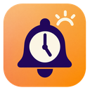

# Day Chime



**한 번 출근시간을 확인하면, 브라우저를 닫아도 퇴근 알림을 받을 수 있습니다.**

다우오피스 홈의 출근시간을 Chromium 확장이 읽고, 로컬 Rust 데몬이 퇴근 예정 시각에 데스크톱 알림을 보냅니다.
OpenAPI 인증키가 필요 없습니다. 기본 기준은 실근무 8시간과 휴게 1시간이며 설정에서 변경할 수 있습니다.

[설치](#빠른-설치) · [릴리스](https://github.com/4mGLn/day-chime/releases) · [MIT License](LICENSE)

## 지원 환경

- 간편 설치·첫 릴리스 바이너리: **Linux x86_64**, GNOME 등 데스크톱 알림 서버가 있는 환경
- 브라우저: Brave, Google Chrome, Chromium
- Python 3.11 이상과 curl이 필요합니다. 압축 해제와 SHA-256 검증에는 Python 표준 라이브러리를 사용합니다. systemd 사용자 서비스를 사용할 수 있으면 로그인 시 자동 실행합니다.
- Windows/macOS는 Rust 소스의 이식 가능성을 유지하지만 이번 설치 스크립트와 사전 빌드 지원 대상은 아닙니다.

## 빠른 설치

회사 주소를 자신의 다우오피스 주소로 바꿔 실행하세요. 관리자 권한이나 Rust 설치는 필요 없습니다.

```bash
curl -fsSL https://raw.githubusercontent.com/4mGLn/day-chime/main/install.sh | sh -s -- \
  --url https://example.daouoffice.com/home \
  --browser brave
```

Chrome은 `--browser chrome`, Chromium은 `--browser chromium`을 사용합니다.
스크립트는 GitHub 릴리스의 바이너리와 SHA-256 체크섬을 내려받아 검증한 뒤 사용자 홈에 설치합니다.
기존 사용자 설정과 알림 상태는 업그레이드 시 보존합니다.

실행 전에 스크립트를 확인하려면 다운로드해서 사용해도 됩니다.

```bash
curl -fsSL https://raw.githubusercontent.com/4mGLn/day-chime/main/install.sh -o install.sh
less install.sh
sh install.sh --url https://example.daouoffice.com/home --browser brave
```

### 브라우저 확장 연결 — 최초 한 번

브라우저는 웹사이트가 확장을 임의로 설치하지 못하도록 제한합니다. 다음 단계는 직접 한 번 진행해야 합니다.

1. 설치 스크립트가 안내한 확장 폴더를 확인합니다. 기본 위치는 `~/.local/share/day-chime/extension`입니다.
2. `brave://extensions` 또는 `chrome://extensions`에서 **개발자 모드**를 켭니다.
3. **압축해제된 확장 프로그램 로드**로 해당 폴더를 선택합니다.
4. Day Chime 카드에 표시되는 32자리 확장 ID를 복사하고 아래 연결 명령을 실행합니다.

```bash
curl -fsSL https://raw.githubusercontent.com/4mGLn/day-chime/main/install.sh | sh -s -- \
  --configure-only --browser brave \
  --extension-id YOUR_32_LETTER_EXTENSION_ID
```

설치 도구가 해당 확장 ID만 로컬 Native Messaging 호스트에 연결하도록 등록합니다.
확장 아이콘에서 성공 상태를 확인하세요. 로그인 만료 시 다우오피스에 직접 로그인해야 합니다.

## 평소 사용 방법

1. 평소처럼 Brave를 실행합니다. 확장이 회사 홈을 백그라운드에서 조회합니다.
2. 오늘 출근 기록이 있으면 로컬에 저장하고, 자신이 연 비활성 탭을 닫습니다.
3. 출근 확인 알림을 받으면 브라우저를 닫아도 됩니다. 데몬이 저장된 시각으로 퇴근 알림을 보냅니다.

출근 전이라 아직 기록이 없으면 브라우저가 실행 중일 때 15분마다 다시 시도합니다.
Brave가 백그라운드 프로세스로 이미 켜져 있었다면 새 창 열기는 시작 이벤트가 아니므로 다음 재시도 주기에 수집할 수 있습니다.
확장은 사용자가 열거나 활성화한 탭을 닫지 않습니다. 로그인 화면 이동이 감지되면 상태에 안내하고 직접 로그인을 기다립니다.
브라우저·컴퓨터가 꺼져 있으면 새 수집은 할 수 없습니다. 예정 시각 알림에는 컴퓨터·사용자 세션과 데몬이 실행 중이어야 합니다.

### 알림 예시

09:00 출근, 실근무 8시간과 휴게 1시간 설정의 예시입니다.

**출근 확인 · 18:00 퇴근 예정**

> 출근 09:00  
> 근무 8시간 · 휴게 1시간 기준  
> 예정 시각에 다시 알려드릴게요.

**이제 퇴근할 시간이에요**

> 오늘 퇴근 예정은 18:00이에요.  
> 퇴근 체크도 잊지 마세요. 오늘도 수고하셨어요!

알림 전송 이력은 별도로 저장해 재시작과 반복 수집의 중복을 줄입니다.
회사 규정을 자동 해석하거나 실제 퇴근 처리를 대신하지는 않습니다.

## 설정과 상태 확인

기본 설정 파일은 `~/.config/day-chime/config.toml`입니다.

```toml
source = "browser"
browser_url = "https://example.daouoffice.com/home"
timezone = "Asia/Seoul"
work_minutes = 480
break_minutes = 60
poll_seconds = 300
```

- `work_minutes`: 실근무 시간, 분 단위
- `break_minutes`: 휴게 시간, 분 단위
- 근무·휴게 합은 최대 24시간입니다. 반차·유연근무 등은 회사 규정에 맞춰 직접 조정하세요.
- 회사 주소를 바꿀 때는 설치 도구의 `--url`로 설정과 확장의 주소를 함께 갱신하고 확장도 새로고침하세요.
- 브라우저 자동 수집의 날짜 기준은 Asia/Seoul입니다. 다른 시간대의 근무는 주의가 필요합니다.

```bash
~/.local/bin/day-chime check
~/.local/bin/day-chime notify-test
systemctl --user status day-chime.service
journalctl --user -u day-chime.service -f
```

업데이트는 최초 설치 명령을 다시 실행하고 확장 관리 화면에서 새로고침을 누릅니다.
특정 릴리스는 `--version v0.4.0`으로 고정할 수 있습니다. 전체 옵션은 `sh install.sh --help`를 확인하세요.
중지는 `systemctl --user disable --now day-chime.service`입니다.

## 데이터와 권한

- 해당 회사의 HTTPS `/home` 화면에서 날짜·출근·퇴근 시각만 읽습니다.
- 쿠키·비밀번호를 수집하지 않고, 출근·퇴근 버튼을 누르지 않습니다.
- 회사별 URL을 설치 시 적용하므로 모든 웹사이트·전체 탭 열람 권한을 요구하지 않습니다.
- 로컬 호스트와 표준 입출력으로 통신하며 HTTP 포트를 열지 않습니다.
- 오늘 받은 출근 기록은 로컬에 저장해 브라우저를 닫거나 데몬을 재시작해도 사용합니다.
- 위젯 로딩 실패는 저장 기록을 지우지 않지만, 실제 미출근 정정·퇴근 완료·출근시각 수정은 반영합니다.
- 브라우저를 닫은 동안의 수정은 반영할 수 없습니다. 홈 위젯의 날짜 표시 방식에 따라 야간근무 수집에도 제한이 있습니다.
- 방해 금지 모드와 알림 서버 정책에 따라 팝업 표시가 달라질 수 있습니다.

설정·근태 상태와 Native Messaging 등록 파일은 공개 저장소 및 릴리스에 포함하지 않습니다.

## 소스에서 빌드

```bash
cargo install --path . --locked --root ~/.local
```

아이콘 설치와 확장·서비스 연결도 필요하므로 일반 사용자는 릴리스 설치 스크립트를 권장합니다.
개발·검증·서명 정책은 [CONTRIBUTING.md](CONTRIBUTING.md), 아이콘 원본은 [assets](assets/)를 참고하세요.

## 라이선스

[MIT](LICENSE) · Copyright (c) 2026 **4mGLn**.
의존성은 각각의 라이선스를 따릅니다. 게시된 모든 커밋에 서명을 사용합니다.
